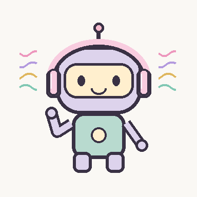

# 用喜欢的图片做一个 Windows 桌宠

一个给 **Codex** 使用的桌宠制作 skill。上传人物、动物或物品图片，描述想要的动作，Codex 会按流程制作透明桌宠、检查动画并安装到你的电脑。

可以保留原来的造型，也可以按你的要求设计新角色。你不用先学编程。



> 上图是用来验证功能的几何机器人示例。你制作的桌宠会使用自己的图片和要求，不必长成这样。

## 能做什么

- **角色动画**：弹吉他、挥手等动作，强调关节自然、主体和道具稳定。
- **音乐联动**：默认监听网易云音乐，播放时做动作，暂停后回到静止状态。
- **可选装饰**：贴合头部的耳机、头部周围的彩色曲线音浪，颜色由你决定。
- **桌面互动**：拖动位置、滚轮放大缩小、双击演示、右键关闭。
- **启动方式**：跟随 Codex 或独立运行；需要时可以添加 Windows 登录自启。
- **在 Codex 中控制**：制作时让 Codex 一并生成你的桌宠控制 skill，就能说“关闭桌宠”“桌宠放大一点”。

这是本地 Windows 桌宠程序，不是 ChatGPT Work 的内置宠物功能。当前模板用于 Windows 10/11，需64位 Python 3.11–3.13（实际验证使用3.13）。生成图片还需要你的 Codex 环境提供图片生成/编辑能力；没有该能力时，可以提供已经画好的透明素材。

## 第一步：安装这个 skill

### 最简单：让 Codex 帮你安装

把下面这句话发给 Codex：

```text
请帮我安装这个 GitHub skill：
https://github.com/z060303/desktop-pet-creator-skill/tree/main/desktop-pet-creator
```

安装后，在下一轮对话输入 `$desktop-pet-creator`。如果暂时没显示，重启 Codex 再试。

### 也可以手动安装

1. 点击本仓库绿色 **Code** 按钮 → **Download ZIP**，然后解压。
2. 打开解压文件夹，把其中的 **desktop-pet-creator** 文件夹复制到 `%USERPROFILE%\.codex\skills`。可以把这个路径直接粘贴到文件资源管理器地址栏。
3. 确认 `desktop-pet-creator` 文件夹里直接有 `SKILL.md`，不要多套一层同名文件夹。
4. 返回 Codex，在下一轮输入 `$desktop-pet-creator`；需要时重启应用。

喜欢使用命令的用户，也可以在仓库文件夹打开 PowerShell，运行：

```powershell
powershell -NoProfile -ExecutionPolicy Bypass -File .\install-skill.ps1
```

已有同名 skill 时，加 `-Update` 更新。若设置了 `CODEX_HOME`，脚本使用其中的 `skills` 文件夹。

## 第二步：上传图片，说出你的想法

拖入一张主体完整、轮廓清楚的图片，再复制下面的例子。方括号里的内容可以换成你喜欢的。

### 保留原造型，制作音乐桌宠

```text
请使用 $desktop-pet-creator，根据我上传的图片做一个 Windows 桌宠。
保留图片里的原造型和配色，不重新设计人物。
网易云音乐播放时，让它[自然地弹吉他]；暂停时停止动作。
音乐播放时戴上[浅樱花粉]头戴式耳机，头部周围出现彩色曲线音浪。
先给我看动画预览，我确认后再安装。
保留拖动、放大缩小和右键关闭功能。
打开 Codex 时显示，退出 Codex 后隐藏；添加 Windows 登录自启。
请同时制作控制 skill，让我能在 Codex 里开启、关闭和调整它的大小。
```

### 自己设计一个角色

```text
请使用 $desktop-pet-creator，制作一个[橘白猫]桌宠。
保留[橘白毛色、圆脸、短尾巴]，动作是[听音乐时摇尾巴]。
先做角色和动画预览，确认后安装。
桌宠独立运行，不依赖 Codex，不添加登录自启。
```

“跟随 Codex”和“登录自启”是两件事：跟随模式的自启先启动后台监视器，只有打开 Codex 才显示桌宠。想登录后立刻看到角色，就选择**独立运行 + 登录自启**。

## 第三步：看预览，再安装

Codex 会先检查角色是否一致、动作是否自然、透明背景和素材尺寸是否正确。你可以直接说：

```text
吉他不要跟着挥动，只调整弹奏手臂，肩膀固定。
耳机换成更浅的粉红色，保持原有功能。
预览可以了，请帮我安装，检查音乐播放/暂停和自启设置。
```

安装时会下载程序依赖，需要联网。若没有合适的 Python，可以先让 Codex 帮你检查并安装。桌宠默认安装到：

```text
你的“文档”文件夹\DesktopPets\你的桌宠id
```

不同桌宠用不同 id，安装位置、设置和自启快捷方式互相独立。重新安装同一个 id 会更新程序和素材，并保留位置与大小。

## 日常怎么用

| 想做什么 | 操作 |
|---|---|
| 移动 | 按住角色拖动 |
| 放大或缩小 | 鼠标放在角色上，滚动滚轮；也可以右键选择 |
| 看动作 | 双击角色，演示5秒 |
| 看播放状态 | 右键，菜单顶部显示音乐检测状态 |
| 关闭 | 右键 → 关闭桌宠；按 Esc 也可以 |
| 再次开启 | 双击安装目录里的 `start.cmd`，或让 Codex 使用已生成的控制 skill |
| 取消登录自启 | 让 Codex 运行安装目录里的 `uninstall.ps1`；它会停止这只桌宠并移除其自启快捷方式，保留文件 |

跟随 Codex 模式下，手动关闭后本次 Codex 会话不会马上重新弹出；重新开启桌宠或重开 Codex 后恢复。独立模式关闭后，可用 `start.cmd` 恢复。

## 遇到问题怎么说

**播放音乐没反应**：让 Codex 检查播放器进程、Windows 媒体会话和音频输出检测。网易云的某些版本没有媒体会话，所以模板还会检测该进程的声音输出。声音检测有约1.25秒的暂停延迟；静音、长静音段或播放器使用非默认输出设备时可能需要调整。彩色音浪是装饰动画，不是实时频谱或节拍分析。

**登录后没看到**：先确认是否选了跟随模式，并打开 Codex；再让 Codex 检查自启快捷方式和实际文件路径。本项目使用“文档”安装目录，避免打包应用的 AppData 私有目录导致普通登录进程找不到文件。不会仅凭快捷方式存在就声称完成了重启验证。

**动作怪、手断开或道具抖动**：要求“固定主体和道具，按关节调整局部动作，给我实际大小的循环预览”。这套 skill 已整理常见原因和修复方法。

## 想先试试现成示例？

发给 Codex：

```text
请使用 $desktop-pet-creator，先运行自带的 demo 音乐机器人。
使用独立运行模式，先不要添加登录自启，帮我确认拖动、缩放和双击动作可用。
```

也可以自己执行以下命令。先安装 Python 和 Pillow（`python -m pip install Pillow`），在仓库文件夹运行：

```powershell
python desktop-pet-creator/scripts/scaffold_pet.py --output demo-pet --id music-bot --name "音乐机器人" --mode standalone --demo
python desktop-pet-creator/scripts/validate_assets.py demo-pet
powershell -NoProfile -ExecutionPolicy Bypass -File .\demo-pet\install.ps1
```

这里没有添加登录自启。需要时在最后一条命令末尾加 `-AutoStart`。
需要在 Codex 里用自然语言控制桌宠时，再加 `-ControlSkill`；它会生成 `music-bot-control` 控制 skill，在后续对话中使用。

## 仓库内容

- `desktop-pet-creator/SKILL.md`：给 Codex 的制作流程。
- `desktop-pet-creator/references/`：角色一致性、自然动作、音乐监听、自启排查与验收说明。
- `desktop-pet-creator/assets/windows-template/`：可复用的桌宠程序、安装脚本和配置。
- `desktop-pet-creator/assets/demo/`：可运行的测试示例素材。
- `desktop-pet-creator/scripts/`：项目创建、素材验证和示例生成工具。
- `install-skill.ps1`：将 skill 安装到当前用户的 Codex 技能目录。

代码和程序绘制的示例采用 [MIT 许可](LICENSE)。每个人自己上传的图片和角色素材不包含在本仓库许可中。

### 开发与验证

在装有模板依赖的 Windows Python 环境中运行 `python tests/smoke.py`，会在临时文件夹验证界面状态、音乐输出回退和应用监视器，不修改现有桌宠或自启设置。具体已验证范围见 [验证记录](docs/verification.md)。
